# VQ-VAE for Synthetic Prostate MRI Generation (HipMRI 2D)

**Author:** Rashim Kaur (s50419139)
**Project:** COMP3710 Report, Section 2.4 Image Generation, VQ-VAE [Hard Difficulty]

## 1. Problem and Algorithm Overview
### 1.1 The problem

Prostate cancer radiotherapy research needs large sets of pelvic MR scans, but patient scans cannot be shared freely. A generative model that produces *synthetic* scans could, in principle, be shared instead. This creates a dilemma. If the model **memorises** its training patients, sharing its output leaks their anatomy and breaches confidentiality. If it **hallucinates** implausible anatomy, models trained on the synthetic cohort learn dangerous artefacts. This project builds a VQ-VAE generator for 2D coronal slices from the HipMRI prostate study and tests, with evidence, whether its output is faithful, diverse and non-memorised, compared with a simpler VAE baseline.

### 1.2 How the VQ-VAE works

A **VQ-VAE** (van den Oord et al., 2017) is an autoencoder whose latent space is *discrete*:

1. **Encoder.** Three stride-2 convolutions and two residual blocks map a 1×256×128 slice to a 32×16 grid of 64-dimensional vectors $z_e$.
2. **Vector quantiser.** Each vector is replaced by its nearest entry in a learned **codebook** of 512 vectors, $z_q = e_k$ with $k = \arg\min_j \lVert z_e - e_j \rVert_2$, so a slice becomes a 32×16 grid of integers.
3. **Decoder.** It mirrors the encoder (residual blocks, then transposed convolutions and a sigmoid) to rebuild the slice from $z_q$.

The training loss is

$$\mathcal{L} = \lVert x - \hat{x} \rVert_2^2 + \beta \, \lVert z_e - \mathrm{sg}[z_q] \rVert_2^2,$$

where sg is the stop-gradient operator and β = 0.25. The first term trains the decoder and encoder to reconstruct the slice. The second (the **commitment loss**) keeps encoder outputs close to their chosen codes. The argmin is not differentiable, so gradients are copied from $z_q$ to $z_e$ with the **straight-through estimator** ($z_q \leftarrow z_e + \mathrm{sg}[z_q - z_e]$). Instead of a codebook loss term, the codebook is updated with **exponential moving averages** of the encoder outputs assigned to each code (paper Appendix A.1). Two further measures prevent **codebook collapse**, a failure observed during development (Section 6.4): the codebook is initialised from real encoder outputs, and codes unused for 50 steps are restarted at random encoder outputs.

**Generating new slices** needs a model of *which code grids are plausible*. A **Gated PixelCNN** prior (van den Oord et al., 2016) is trained on the code grids of the training set to predict each code from the codes above and to the left of it. Sampling a grid code by code and passing it through the decoder produces a new slice.

**Baseline.** A convolutional **VAE** (Kingma & Welling, 2014) uses the same encoder/decoder backbone, but its latent is a continuous Gaussian (8 channels on the same 32×16 grid). It is trained with summed squared error plus a KL term, with the KL weight warmed up over 5 epochs (Bowman et al., 2016), and it generates by decoding $z \sim \mathcal{N}(0, I)$. Because the backbone is shared, the comparison isolates the effect of discrete versus continuous latents.

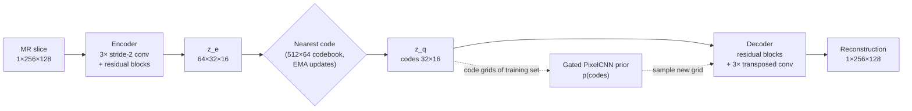

*Solid arrows: reconstruction (stage 1, trained first). Dotted arrows: generation (stage 2, prior trained on frozen codes).*

### 1.3 Repository structure

| File | Purpose |
|---|---|
| `dataset.py` | Loads Nifti slices, centre-crops to 256×128, normalises each slice, caches tensors, builds DataLoaders |
| `modules.py` | VQ-VAE (encoder, EMA vector quantiser, decoder), VAE baseline, Gated PixelCNN prior. Running it executes the self-tests |
| `train.py` | Training/validation loops for all three models, checkpoints, curves and logs of time and peak GPU memory |
| `predict.py` | Loads trained weights and runs the test-set evaluation, failure analysis, sampling, memorisation audit, interpolation and profiling |
| `utils.py` | SSIM (validated against scikit-image), PSNR, masked SSIM, seeding and figure helpers |
| `data_audit.py` | Pre-training dataset audit (shapes, intensities, labels, image/mask pairing, patient leakage) |
| `train.sh`, `predict.sh` | Slurm job scripts for the Rangpur cluster |

## 2. Feasibility Review (Midpoint Check-Off)
*One-page review presented at the compulsory midpoint check-off (updated 23 Oct 2026 with the first full evaluation). Later results are in Section 6.*

**1. User need, scope and acceptance criteria.**
The user is a radiotherapy research group that wants to share a synthetic cohort of 2D pelvic MR slices with collaborators, so that they can develop segmentation models without access to real patient scans. The open dilemma: *does the generator produce novel, diverse and anatomically coherent slices, or does it copy training patients or collapse to a few modes?* Criteria are measured on held-out data; status is from the first full evaluation (run A, 32×16 code grid).

| # | Acceptance criterion | Status |
|---|---|---|
| AC1 | **Fidelity:** mean test reconstruction SSIM > 0.6 and above a VAE baseline of similar size | **Met.** Test SSIM 0.735 vs VAE 0.456; best ablation run reaches 0.933 (validation) |
| AC2 | **Plausibility:** samples are as similar to real anatomy as real patients are to each other (median SSIM to nearest training slice ≥ the real test-patient reference). *Revised from "> 0.6": even real unseen slices reach only 0.27 against their nearest training slice, so 0.6 is unreachable.* | **Partly.** 0.293 vs reference 0.271, but visually the samples lack global anatomy |
| AC3 | **No memorisation:** ≤ 10% of samples closer to a training slice than τ (5th percentile of real test→train distances), and no visual or code-grid copies | **Borderline.** 11.3% below τ, but these are low-detail slices, not copies (pair SSIM ≤ 0.44; code overlap 6.4% vs 6.2% for real patients) |
| AC4 | **Diversity:** codebook perplexity > 256 of 512, no mode collapse in uncurated grids | **Met.** Perplexity 376; samples varied |
| AC5 | **Resources:** < 1 GPU-hour and < 8 GB VRAM per model on one A100; generation < 1 s per slice | **Met** (≤ 1.7 GB; 155 ms/slice). The 64×32 prior is still being measured |

**2. Model choice and course concepts.**
HipMRI 2D (256×128 coronal slices), with the provided patient-level splits (31 / 4 / 3 patients) and per-slice percentile normalisation. **VQ-VAE** (van den Oord et al., 2017): residual conv encoder/decoder, a 512×64 codebook with EMA updates, commitment loss (β = 0.25) and the straight-through estimator. A **Gated PixelCNN** prior (van den Oord et al., 2016) generates new code grids. Baseline: a **convolutional VAE** (Kingma & Welling, 2014) with the same backbone, so the comparison isolates discrete versus continuous latents. Course concepts: convolutional autoencoders, residual blocks, variational inference, autoregressive models, masked convolutions.

**3. Feasibility evidence.**

- *Data audit:* no patient overlap between splits; prostate < 1% of pixels, so SSIM is also measured inside each organ.
- *Ablation* (validation SSIM): baseline 0.698 → 150 epochs 0.747 → + SSIM loss 0.795 → + 64×32 code grid **0.933**.
- *Test-set findings (run A):* SSIM falls from about 0.80 to 0.65 with slice depth; the worst slices contain fine bowel-gas texture that the model smooths. Prostate SSIM is only 0.518 (0.205 on one slice whose whole-slice SSIM is 0.754), so overall SSIM hides poor organ detail. The VAE's samples contain no anatomy at all (a "prior hole"). VQ-VAE latent interpolation between patients is smooth and plausible.
- *Bugs found and fixed:* codebook collapse (perplexity 1 → 376), a PixelCNN receptive field covering only 14 of 32 rows (widened to 31), and an SSIM loss broken by bfloat16 autocast (0.178 → 0.795 once computed in float32).

**4. Risks, budget and fallback.**

- *Main risk: incoherent samples.* The prior learns local texture but not whole-pelvis layout, and it overfits after about 15 epochs. Next experiments: sampling temperature (0.7, 0.85), the prior for the 64×32 grid (31 layers, running), and a prior conditioned on slice position.
- *Risk: RMSE-based memorisation tests are confounded* by low-detail slices. Mitigation: pair SSIM, code-grid overlap and visual inspection.
- *Risk: small test set* (3 patients). Mitigation: per-patient reporting.
- *Budget:* under 2 GPU-hours used so far; each run takes 3–20 min, with the 64×32 prior about 1 h.
- *Fallback:* if no prior gives coherent slices, recommend against releasing a synthetic cohort, and report the VQ-VAE as a high-fidelity compressor (0.93 validation SSIM) with a smooth latent space. A non-memorised but implausible cohort is safe, but not useful.

## 3. Dataset, Pre-processing and Splits
### 3.1 Data audit

Before writing the data loader, the HipMRI 2D slice dataset (`keras_slices_data` on Rangpur) was audited with `data_audit.py`, which checks slice counts, shapes, intensity ranges, label balance, image/mask pairing and patient overlap between splits.

| Split | Slices | Patients | Slice shapes |
|---|---|---|---|
| Train | 11,460 | 31 | 256×128 (11,400), 256×144 (60) |
| Validate | 660 | 4 | 256×128 |
| Test | 540 | 3 | 256×128 |

Key findings:

- **No patient leakage.** No patient (case ID) appears in more than one split, so the provided splits are patient-level and are kept as-is (38 patients in total, matching the dataset description).
- **Image/mask pairing is complete.** Every image slice has a matching segmentation mask in all three splits.
- **Mixed slice shapes.** 60 training slices are 256×144. These are centre-cropped to 256×128 rather than resized, to avoid interpolation blur.
- **Raw MR intensities.** Values are non-negative floats with per-slice maxima varying widely (sampled maxima up to 1080, median around 400), so intensities are normalised per slice (percentile clipping, then scaling to [0, 1]).
- **Extreme class imbalance in the masks.** Sampled pixel fractions are roughly 16% label 0, 68% label 1, 12% label 2, 2% label 3, 0.5% label 4 and 0.4% label 5. Per the dataset description, the labelled regions are background, body outline, bone, bladder, rectum and prostate. The prostate occupies well under 1% of each slice, so whole-image metrics can hide poor detail in the clinically important region. Masks are therefore used during evaluation to measure reconstruction quality inside each organ.
- **Repeated scans per patient.** Patients contribute up to 480 slices across multiple weekly scans, so neighbouring training slices are highly similar. The memorisation audit accounts for this by comparing generated images against both training and held-out test patients.
- **Limitation:** the test split contains only 3 patients, so test metrics carry patient-level variance and are reported with that caveat.

### 3.2 Label verification

The label meanings were confirmed visually before being used in evaluation (`python dataset.py` saves this figure). Label 2 covers the pelvic bones and femurs, label 3 the bladder, label 4 the rectum and label 5 the prostate, directly inferior to the bladder.


### 3.3 Pre-processing (`dataset.py`)

1. **Crop.** Every slice is centre-cropped (or zero-padded) to 256×128. The 60 slices of width 144 lose 8 columns from each side, which are background.
2. **Normalise.** Each slice is clipped to its own 0.5th–99.5th intensity percentiles and scaled to [0, 1]. MR intensities have no absolute scale, and percentile clipping stops a few very bright voxels from compressing the useful range.
3. **Cache.** Pre-processed slices are cached as float16 tensors (about 1 GB, git-ignored), so later runs load in seconds instead of decoding about 12,700 Nifti files.
4. **Masks** are cropped identically and used only for evaluation, never for training the generative models.

After pre-processing, mean intensity is similar across splits (train 0.220, validate 0.236, test 0.213), so the held-out splits are not distribution-shifted. About 36% of slices contain prostate (train 36.2%, validate 38.5%, test 36.1%), so prostate-region metrics are computed only on those slices.

### 3.4 Split justification

The provided train / validate / test folders are used unchanged because the audit found no patient in more than one split. Slices from one patient are highly correlated (repeated weekly scans of the same anatomy), so a random slice-level split would leak patient anatomy into the test set and overstate both reconstruction quality and novelty in the memorisation audit.

## 4. Dependencies and Reproducibility
**Software.** All results were produced with the following versions (also pinned in `environment.yml`):

| Package | Version | Used for |
|---|---|---|
| Python | 3.11.15 | |
| PyTorch | 2.14.1 (CUDA 13.0) | models, training, metrics |
| torchvision | 0.29.1 | installed with PyTorch (not imported by the project code) |
| nibabel | 5.4.2 | reading Nifti slices |
| NumPy | 2.4.6 | Nifti → tensor conversion, figures (not used in `modules.py`) |
| scikit-image | 0.26.0 | reference SSIM in the `utils.py` self-test |
| matplotlib | 3.11.2 | figures |
| SciPy | 1.17.1 | scikit-image dependency |
| tqdm | 4.70.1 | progress bars |

```bash
conda env create -f environment.yml
conda activate comp3710
```

**Hardware.** Training and evaluation ran on one NVIDIA A100-PCIE-40GB on the UQ Rangpur cluster (`comp3710` partition), and pre-processing and self-tests on a CPU node. No model needs more than about 2 GB of GPU memory (Section 6.2), so any recent CUDA GPU should work.

**Determinism.** Training uses seed 42 (`--seed`), and `predict.py` uses seed 0 for sampling. Data splits are fixed by the dataset folders, and pre-processing is deterministic (cached under a versioned file name, so a change to pre-processing cannot silently reuse a stale cache). GPU training uses bfloat16 autocast and non-deterministic cuDNN kernels, so re-running gives slightly different numbers (small differences in the last reported digit), but the same conclusions.

**Reproducing the results.** Follow Section 5 in order: audit and cache the data, run the self-tests, train the VQ-VAE and the VAE, train the PixelCNN on the chosen VQ-VAE, then run `predict.py`. Exact commands and settings for every reported run are given with each result in Section 6.

## 5. Usage
All commands are run from this folder. On Rangpur, GPU work is submitted with the Slurm scripts, and short checks run on a CPU node (`srun -p cpu --cpus-per-task=2 --time=00:30:00 --pty bash`). The data path defaults to `/home/groups/comp3710/HipMRI_Study_open/keras_slices_data`; pass `--root` to use another copy.

**1. Audit the data and build the cache** (CPU, a few minutes on first run):

```bash
python data_audit.py          # prints the audit, saves audit_outputs/sample_slices.png
python dataset.py             # caches pre-processed tensors to data/cache/, saves audit_outputs/label_check.png
```

**2. Run the self-tests** (CPU, under a minute). These check shapes, codebook initialisation, recovery from codebook collapse, PixelCNN causality, and SSIM against scikit-image:

```bash
python modules.py
python utils.py
```

**3. Smoke-test training** (CPU, a few batches; catches bugs before using GPU time):

```bash
python train.py --model vqvae --smoke
python train.py --model vae --smoke
python train.py --model pixelcnn --smoke
```

**4. Train on a GPU.** The PixelCNN must be trained after the VQ-VAE, because it learns the VQ-VAE's code grids:

```bash
sbatch train.sh vqvae --epochs 150                  # -> outputs/vqvae/
sbatch train.sh vae                                 # -> outputs/vae/
sbatch --dependency=afterok:<vqvae_job_id> train.sh pixelcnn
```

Useful options: `--out-dir`, `--epochs`, `--batch-size`, `--lr`, `--n-down` (3 gives a 32×16 code grid, 2 gives 64×32), `--ssim-weight`, `--num-embeddings`, `--prior-layers`, `--prior-kernel`. Each run writes `best.pt`, `last.pt`, `history.json`, `summary.json`, `curves.png` and `recon_latest.png` to its output folder.

**5. Evaluate on the test split and generate samples:**

```bash
sbatch predict.sh                                   # all tasks -> results/
sbatch predict.sh --tasks evaluate,failures         # a subset
sbatch predict.sh --vqvae outputs/vqvae_e150/best.pt --out results/final
```

`predict.py` writes all tables to `results/report.md` and figures to `results/`. Model weights, caches and results are not committed (see `.gitignore`); figures used in this README are copied to `images/`.

Example input and output: see Section 6.1 (`images/final_test_examples.png` for reconstructions, `images/final_samples_vqvae.png` for generated slices).

## 6. Results

All test-set numbers come from `predict.py` on the 540 slices of the 3 held-out test patients. Those patients were never used for training or model selection: every model and setting was chosen on the validation split.

### 6.1 Baseline (VAE) vs VQ-VAE

**Model selection (ablation, validation SSIM).** Each run adds one change to the previous one:

| Run | Configuration | VQ-VAE val SSIM | Command |
|---|---|---|---|
| A | 32×16 code grid, 40 epochs | 0.698 | `sbatch train.sh vqvae` |
| B | + 150 epochs | 0.747 | `... --epochs 150` |
| C | + SSIM loss term (weight 0.1) | 0.795 | `... --ssim-weight 0.1` |
| **D** | **+ 64×32 code grid** (2 downsamplings instead of 3) | **0.933** | `... --n-down 2` |

Run D is the final model. For a fair comparison, the VAE baseline was retrained with **the same three advantages** (150 epochs, SSIM term, 64×32 latent), which raised its validation SSIM from 0.436 to 0.659. Both versions are reported below.

**Training curves (final configuration, 64×32 grid).** Validation metrics are computed every epoch on the 4 validation patients. The checkpoint with the best validation score is kept (`best.pt`).

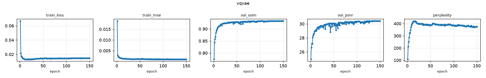
*VQ-VAE: training loss falls within a few epochs. Validation SSIM rises to about 0.93 by roughly epoch 50 and then plateaus, with no sign of overfitting. Codebook perplexity peaks near 400 early and settles at about 375 of 512, so no collapse occurs at any point.*

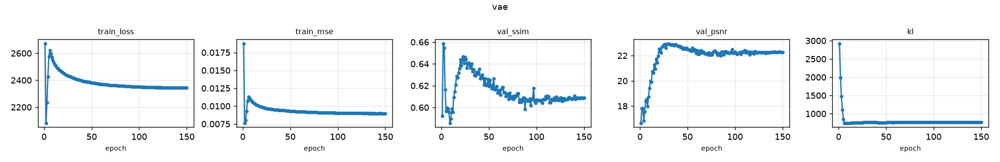
*VAE: the early rise in training loss is the KL warm-up (its weight ramps from 0 to 1 over 5 epochs). Validation SSIM is highest at epoch 2 (0.659), while the KL weight is still only about 0.4. It then drops as the KL term takes full effect, recovers to about 0.645 around epoch 20, and drifts down to about 0.61, while PSNR stays flat: the KL term keeps pulling the latent toward $\mathcal{N}(0, I)$ at the cost of structural detail. **Caveat:** best-checkpoint selection therefore picked the epoch-2 model, which is barely regularised (the same happened in run A). This flatters the VAE's reconstructions and is not a fully trained VAE. `train.py` now only selects VAE checkpoints after the warm-up, and the fully trained epoch-150 VAE is also reported below.*

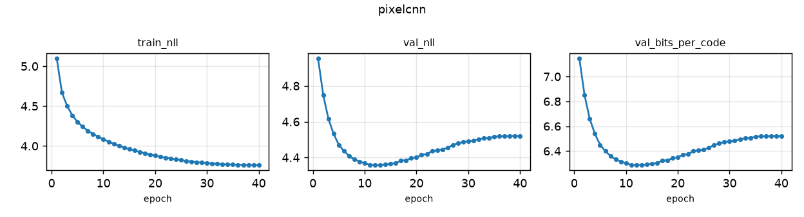
*PixelCNN prior: training NLL keeps falling, but validation NLL reaches its minimum around epoch 12 and then rises, even with dropout 0.1. The prior starts to fit training-set code patterns that do not generalise, which is the early sign of memorisation. The best-validation checkpoint (epoch ~12) is used for all sampling, and the audit in Section 6.3 checks that no copying reached the samples.*

**Overfitting check (generalisation).** The same models reconstruct every slice of all three splits (`predict.py --tasks generalisation`):

| Model | Train SSIM (11,460 slices, 31 patients) | Validate SSIM (660, 4) | Test SSIM (540, 3) | Train − test gap | Train / test PSNR (dB) |
|---|---|---|---|---|---|
| VQ-VAE final | 0.937 | 0.934 | **0.944** | −0.007 | 30.32 / 31.09 |
| VAE matched (epoch-2 checkpoint) | 0.671 | 0.659 | 0.688 | −0.017 | 18.09 / 18.31 |

**The VQ-VAE does not overfit:** it reconstructs patients it has never seen as well as its training patients. Test is marginally higher than train, most likely because the 3 test patients are slightly easier on average (with only 3 patients, a difference of 0.007 is within patient-to-patient variation, which spans 0.933–0.945). A memorising autoencoder would show train SSIM well above test. This also rules out the concern that the high SSIM comes from fitting the 31 training patients. Overfitting does appear in the **PixelCNN prior** (rising validation NLL after about epoch 12, see the curves above), and is controlled there by best-checkpoint selection and audited in Section 6.3.

**Test-set reconstruction (mean ± std over 540 slices):**

| Metric | VQ-VAE run A (32×16) | **VQ-VAE final (64×32)** | VAE run A | **VAE matched (64×32)** |
|---|---|---|---|---|
| SSIM, whole slice | 0.735 ± 0.035 | **0.944 ± 0.010** | 0.456 ± 0.024 | 0.688 ± 0.026 |
| PSNR (dB) | 25.06 | **31.09** | 17.03 | 18.31 |
| MSE | 0.0033 | **0.0008** | 0.0203 | 0.0149 |
| SSIM in bladder | 0.769 | **0.939** | 0.470 | 0.670 |
| SSIM in rectum | 0.596 | **0.897** | 0.392 | 0.636 |
| SSIM in prostate | 0.518 | **0.874** | 0.281 | 0.538 |
| Slices with SSIM > 0.6 | 100% | **100%** | 0% | 100% |
| SSIM per patient (40 / 41 / 42) | 0.739 / 0.736 / 0.706 | **0.945 / 0.942 / 0.933** | 0.456 / 0.461 / 0.452 | 0.691 / 0.687 / 0.670 |

Organ SSIM is averaged over slices where the organ covers ≥ 50 pixels (bladder n = 399, rectum n = 212, prostate n = 181).

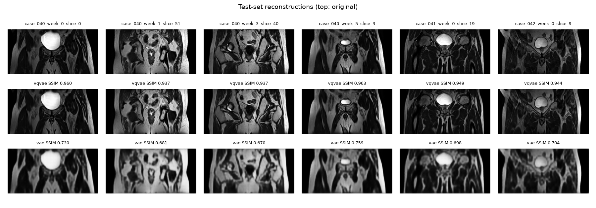
*Test slices (top), final VQ-VAE reconstructions (middle) and matched-VAE reconstructions (bottom).*

**Findings.**
- **The target is exceeded by a wide margin.** The final VQ-VAE reaches a test SSIM of 0.944, and every test slice is above 0.6. It also beats an equally well-trained VAE by +0.26 SSIM and +12.8 dB PSNR, using a similar number of parameters (0.82M vs 0.75M), so the gain comes from the discrete latent rather than from extra capacity or training.
- **Whole-slice SSIM hides organ-level errors.** In run A the whole-slice SSIM was 0.735, but only 0.518 inside the prostate. One slice scored 0.754 overall and only 0.205 inside the prostate, because the model reproduced the bright bladder and smoothed the prostate's internal texture to flat grey. The 64×32 grid largely closes this gap (prostate 0.874), which is why organ-level metrics are reported alongside whole-slice SSIM.

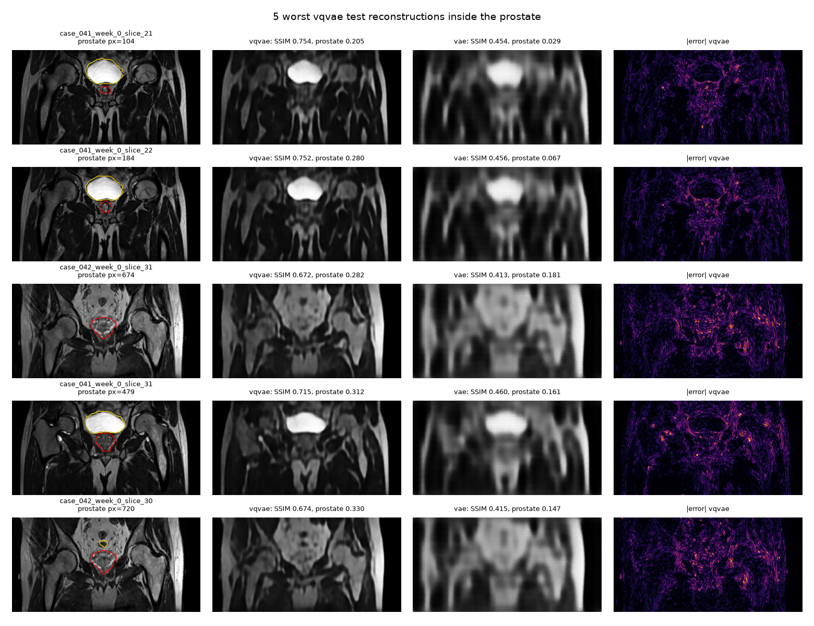
*Run A (32×16 grid): the worst prostate reconstructions. Whole-slice SSIM about 0.75, prostate SSIM as low as 0.205.*

- **Results are consistent across patients** (0.933–0.945), so they are not driven by one easy test patient.

**Generation.** VQ-VAE samples are drawn from the PixelCNN prior, and VAE samples by decoding $z \sim \mathcal{N}(0, I)$. All grids are uncurated (the first 32 of 256 samples).

| | Run A prior (32×16, 15 layers) | **Final prior (64×32, 31 layers)** |
|---|---|---|
| Receptive field | 31 of 32 rows | 63 of 64 rows |
| Best validation NLL (bits per code) | 6.60 | 6.29 |

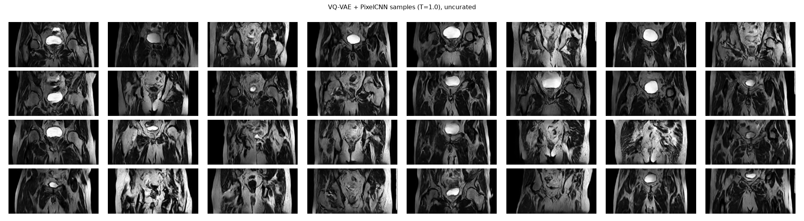
*Final VQ-VAE + PixelCNN samples (T = 1.0, uncurated). Most show a coherent pelvis: a central bladder, symmetric femoral heads and pelvic bones, body outline and subcutaneous fat, with bowel loops in the higher slices.*

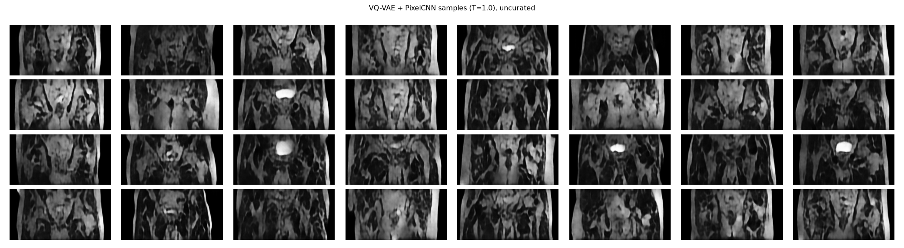
*Run A samples (32×16 grid) for comparison: realistic local texture but no coherent global anatomy.*

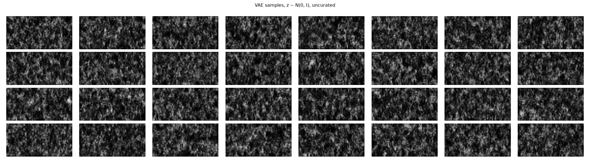
*Matched-VAE samples: texture with no anatomy at all.*

- **The finer code grid transformed sample quality.** Run A samples had MR-like texture, but no whole-pelvis layout. Final samples mostly look like plausible coronal pelvic slices. Each code now covers a 4×4-pixel patch instead of 8×8, and the prior (with a receptive field over the whole grid) learns a lower-entropy distribution (6.29 vs 6.60 bits per code).
- **The VAE cannot generate at all**, even though its reconstructions are recognisable. This is the "prior hole" problem: the latents the encoder actually uses do not match $\mathcal{N}(0, I)$, so samples land in regions the decoder never learned. The VQ-VAE avoids it by learning its prior separately, on the codes it actually uses.
- **Interpolation.** Decoding linear blends of the encoder outputs of two test patients changes the image smoothly: the bladder fills in gradually while the bowel loops fade, and the end points and most intermediate frames look anatomically plausible. Around the midpoint, frames partly look like the two anatomies superimposed ("ghosting"), because linear blending of encoder features does not follow the anatomy. The latent space is continuous and organised, but straight lines through it are not guaranteed to stay on realistic anatomy. The VAE interpolates smoothly too, but every frame is blurred.

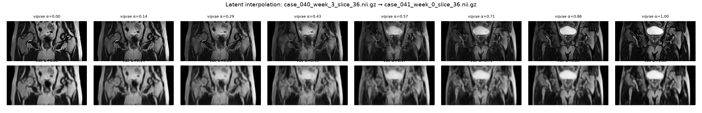

### 6.2 Resource Profiling

Measured on one NVIDIA A100-PCIE-40GB (`predict.py --tasks profile` and training logs):

| Cost | VQ-VAE run A (32×16) | **VQ-VAE final (64×32)** | VAE matched (64×32) |
|---|---|---|---|
| Parameters, autoencoder | 886,401 | 821,825 | 751,121 |
| Parameters, PixelCNN prior | 10,942,592 | 21,704,832 | none |
| Autoencoder training time | 161 s (40 epochs) | 1,501 s (150 epochs) | 1,267 s (150 epochs) |
| Autoencoder peak GPU memory, training | 419 MB | 1,348 MB | 628 MB |
| Prior training time | 618 s | 2,355 s | none |
| **Prior peak GPU memory, training** | 1,663 MB | **10,944 MB** | none |
| Reconstruction latency, batch 1 | ~1.7 ms | 1.60 ms | 1.12 ms |
| Reconstruction throughput, batch 64 | ~9,000–12,000 slices/s | 5,711 slices/s | 8,734 slices/s |
| **Generation time per slice** | 152 ms | **4,368 ms** | 0.06 ms |

**The dilemma in numbers.** Halving the code-grid spacing improved reconstruction (+0.21 SSIM) and samples (above), but quadrupled the length of the sequence the prior must model. The prior needs 2× the layers to see the whole grid, **28× longer to sample a slice** (4.4 s), and **6.6× more training memory** (10.9 GB). The autoencoder itself stays cheap (1.3 GB, 25 min). Reconstruction is never the bottleneck; generation is. A 1,000-slice synthetic cohort takes about 73 GPU-minutes with the final model, against under 3 minutes with run A, and essentially no time with the VAE, whose samples are, however, unusable.

### 6.3 Memorisation and Privacy Audit

**Method.** For every slice we compute the RMSE to its nearest training slice (a search over all 11,460). Real slices from the 3 *unseen* test patients define what "genuinely new anatomy" looks like: the threshold τ = 0.1446 is the 5th percentile of their distances, so by construction 5% of real new slices fall below it. A generator that copies training patients places far more than 5% of its samples below τ. Because pixel RMSE can be fooled by simple images, three further checks are reported: SSIM between each sample and its nearest training slice, **code-grid overlap** (the largest fraction of the 2,048 code positions a sample shares with any training slice's grid), and visual inspection of the closest pairs.

| 256 samples per model | Real test → train | VQ-VAE run A | **VQ-VAE final** | VAE matched |
|---|---|---|---|---|
| Fraction below τ (memorisation signal) | 5% (by definition) | 11.3% | **2.7%** | 0.0% |
| Median / min NN RMSE | 0.169 / 0.136 | 0.170 / 0.108 | 0.184 / 0.122 | 0.194 / 0.176 |
| Median / max SSIM to nearest training slice | 0.271 / 0.399 | 0.293 / 0.441 | 0.253 / 0.415 | 0.129 / 0.160 |
| Code-grid overlap, median (max) | 7.3% (11.7%)\* | 6.4% (15.4%) | 6.2% (19.8%) | n/a |

\*Reference for the final codebook. With run A's codebook, real test slices give 6.2% (11.5%).

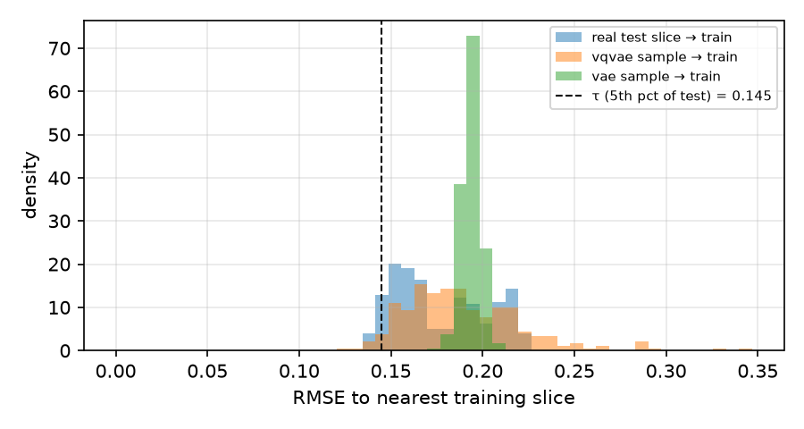
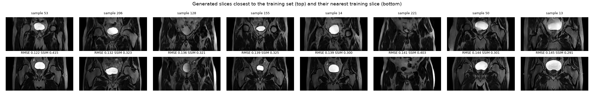
*The 8 final samples closest to the training set (top) and their nearest training slice (bottom).*

**Findings.**
- **No evidence of memorisation in the final model.** Only 2.7% of samples fall below τ, fewer than the 5% expected for genuinely new patients. Their distance distribution overlaps that of real unseen patients, and the median code-grid overlap (6.2%) is no higher than for real patients (7.3%). The closest pairs share a bladder position and femoral-head layout, but have visibly different anatomy (pair SSIM 0.29–0.42).
- **Run A's 11.3% was a measurement confound, not copying.** Its closest samples were mostly dark slices with one bright bladder blob. Pixel RMSE is dominated by large dark regions, so such simple images sit "close" to many training slices, even though their nearest neighbours had different anatomy (SSIM 0.30–0.44) and code overlap matched real patients. Pixel distance alone over-reports memorisation for low-detail samples.
- **Sampling temperature trades plausibility for privacy.** Sampling run A's prior at lower temperatures makes it pick more confident codes:

| Run A prior | T = 1.0 | T = 0.85 | T = 0.70 |
|---|---|---|---|
| Fraction below τ | 11.3% | 23.0% | 24.6% |
| Median code-grid overlap | 6.4% | 7.0% | 8.2% |
| Median SSIM to nearest training / test slice | 0.293 / 0.245 | 0.316 / 0.268 | 0.331 / 0.271 |

Lowering T makes samples smoother and more "typical" (higher SSIM to real slices), but more than **doubles** the fraction that sits suspiciously close to training slices, and steadily increases code reuse. Visually, T = 0.7 samples are blob-like and less detailed (below). **Temperature is a privacy control, not just a quality knob:** release samples at T = 1.0.

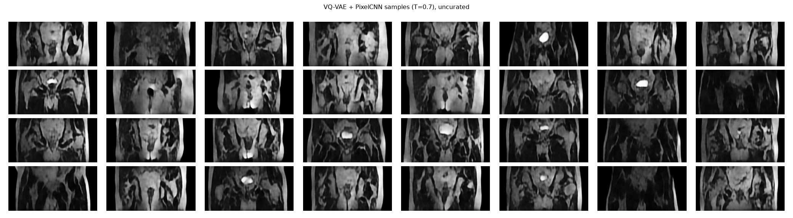

- **Plausibility metric: a lesson.** The midpoint review proposed "median SSIM of each sample to its nearest real slice > 0.6" (AC2). This proved unreachable even for real data: real unseen slices reach only 0.271 against their nearest training slice, because anatomy, positioning and slice depth differ between patients. AC2 was therefore revised to compare against that real-data reference. Even so, nearest-neighbour SSIM disagrees with visual quality. The final model's samples look **far more** anatomically plausible than run A's, yet score lower (0.253 vs 0.293), because realistic fine texture that does not align pixel-for-pixel is penalised more than smooth, generic texture. Nearest-neighbour SSIM is not a reliable plausibility measure, so visual inspection was used as the primary evidence. (A learned-feature metric such as FID was not used: it needs a pretrained network that could not be downloaded on the cluster, and ImageNet features are themselves a questionable fit for MR.)
### 6.4 Failure Case Autopsy

#### 6.4.1 Failures found and fixed during development

Three failures were caught by self-tests and CPU smoke runs before they could affect the reported results. Each is kept here because it changed the design.

| # | Symptom | Diagnosis | Fix | Evidence after fix |
|---|---|---|---|---|
| F1 | **Codebook collapse.** The untrained model mapped every position to one code (perplexity 1.0 of 512). After adding data-dependent initialisation, a smoke run still collapsed from perplexity 76 to 1.0 within 10 steps. | Early in training the encoder outputs move faster than the codebook can follow, so every output ends up nearest the same code. The first dead-code rule only restarted a code once its EMA usage fell below 1, which took about 400 steps. | Initialise the codebook from real encoder outputs, and restart any code unused for 50 consecutive steps at a random current encoder output. | Smoke run: perplexity 1.0 → 156 at the first restart, then 100–200. Full run: 376/512 codes in use. A self-test forces a collapse and checks recovery. |
| F2 | **Incoherent samples.** The first PixelCNN produced realistic local texture but no coherent pelvis (scattered bones, one-sided black regions). | Receptive field: 12 gated layers with 3×3 kernels let each position see only 14 of the 32 code rows above it, so the lower half of a slice was generated without seeing the upper half. | 15 layers with 5×5 kernels (receptive field of 31 rows, i.e. the whole grid), plus dropout 0.1 against the overfitting seen in v1 (validation NLL minimum at epoch ~15, then rising). | Best validation NLL 4.588 → 4.577 nats/code. Visual comparison in Section 6.3. |
| F3 | **SSIM-loss runs failed.** Adding 0.1·(1 − SSIM) to the loss gave best validation SSIM 0.178 and 0.054, against 0.747 without it. Loss and validation SSIM were flat from epoch 1 (0.19 and 0.162). | SSIM was computed inside the bfloat16 autocast region. Its variance terms are differences of nearly equal numbers (E[x²] − E[x]²), which bfloat16 (~3 significant digits) gets badly wrong, so the SSIM gradient was meaningless and stopped the model learning. | Compute SSIM in float32 with autocast disabled. Training now also stops immediately on a non-finite loss. | Re-running the same settings: best validation SSIM 0.178 → **0.795** (32×16 grid) and 0.054 → **0.933** (64×32 grid). |
#### 6.4.2 Test-set failure cases (final VQ-VAE)

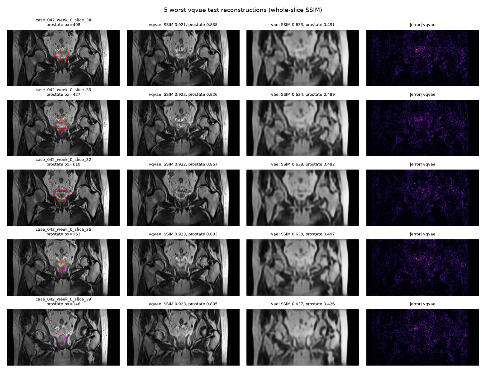
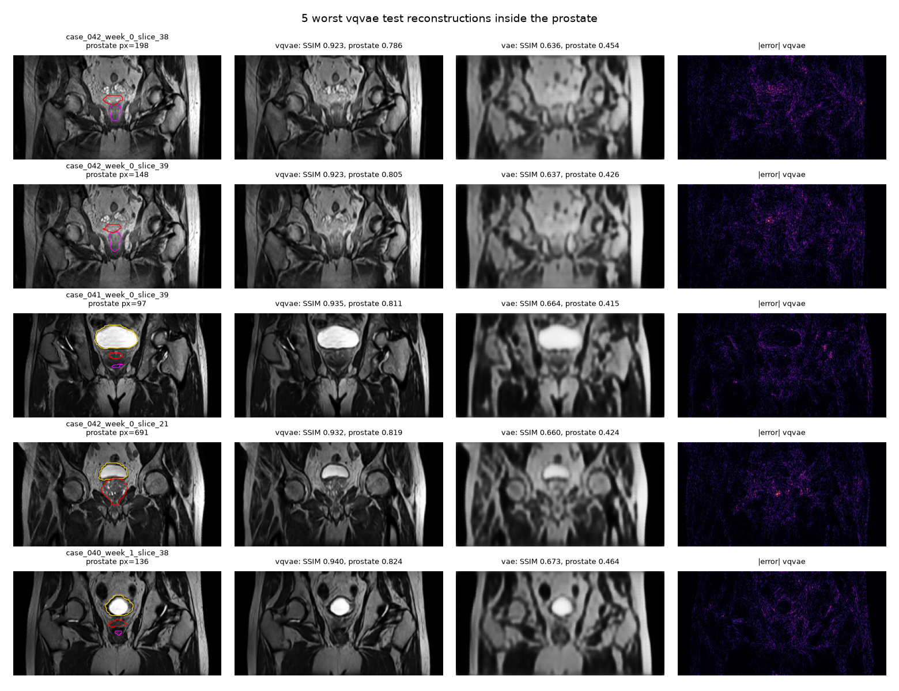
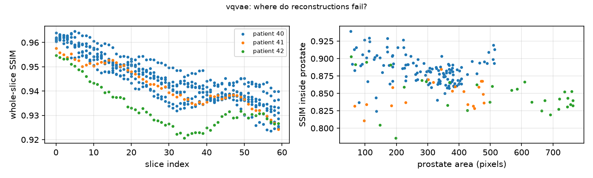

1. **Fine, high-contrast speckled texture (patient 42, week 0, slices 32–39).** All five worst whole-slice reconstructions (SSIM 0.921–0.923) are consecutive slices from one scan session, with mottled bowel loops in the upper pelvis and small bright speckles around and just above the prostate. In the final model the error maps concentrate on that speckled region, which is reconstructed as smoother, lower-contrast texture, while the rest of the slice has little error. Each code represents a 4×4-pixel patch drawn from a 512-entry codebook, and this high-frequency, patient-specific texture is rare in training data, so it is approximated by smoother codes. The same slices were the worst in run A, where they dropped to SSIM 0.65 and the error was spread over the whole slice.
2. **Prostate detail.** The worst prostate reconstructions (prostate SSIM 0.786–0.824) are either small (97–198 pixels), where a few misplaced pixels dominate the score, or large with heterogeneous internal texture (691 pixels, patient 42), where fine internal structure is smoothed. Run A failed badly on the same kind of slice (prostate SSIM as low as 0.205); the final model keeps the prostate outline and most of its internal texture.
3. **Slice position.** Whole-slice SSIM falls steadily with slice index (from about 0.96 to about 0.93; in run A from about 0.80 to about 0.70), as slices further through the volume contain more bowel and fine structure. Patient 42 dips to about 0.92 at slices 32–40, the speckled slices above. Inside the prostate, SSIM drifts down slightly as the gland gets larger (more internal texture to reproduce), with patient 41 consistently lowest.
4. **Sample artefacts.** A few generated slices have a thin bright vertical line along the right image edge, or asymmetric pelvic bones (visible in the sample grid). They do not appear in reconstructions, so they come from the prior, not the decoder. A likely cause is single unlikely codes sampled at the right-hand border, where a raster-order PixelCNN has the least context about what lies beyond the edge.
5. **Overfitting of the prior.** With only 31 training patients, PixelCNN validation NLL reached its minimum early and then rose, even with dropout. The best-validation checkpoint is used, but more patients (or conditioning on slice position) would be the most direct fix for both coherence and memorisation risk.

### 6.5 Recommendation to Project Manager

**Question: is the generated cohort safe, non-memorised and clinically plausible enough for downstream training?**

| Acceptance criterion | Final result | Verdict |
|---|---|---|
| AC1 Fidelity | Test SSIM 0.944 (prostate 0.874) vs matched VAE 0.688 | ✅ Met |
| AC2 Plausibility | Visually coherent pelvic anatomy in most samples; nearest-neighbour SSIM 0.253 vs real reference 0.271 (a weak metric, see 6.3) | ⚠️ Largely met visually, not by the metric |
| AC3 No memorisation | 2.7% below τ (real patients: 5%); code overlap at real-patient level; no visual copies | ✅ Met |
| AC4 Diversity | Codebook perplexity 374 of 512 at the end of training (target > 256); uncurated samples vary in slice depth, bladder size and anatomy, with no mode collapse | ✅ Met |
| AC5 Resources | Autoencoder 1.3 GB / 25 min ✅; prior 10.9 GB (> 8 GB) and 4.4 s per slice (> 1 s) | ❌ Generation exceeds budget |

**Recommendation: approve the final VQ-VAE for a limited internal pilot, not for external release.**

1. **Privacy: acceptable, with a release gate.** Nothing in the audit suggests that patients are being reproduced. Because the audit is empirical (3 test patients, pixel and code distances) and not a formal guarantee, every released batch should be screened automatically: discard any sample below τ, and keep sampling at T = 1.0, since lower temperatures more than doubled near-copies.
2. **Plausibility: promising, not yet clinical.** Most samples show coherent pelvic anatomy, but some have artefacts, and no clinician has reviewed them. A radiation oncologist should rate a random subset before the cohort is used for anything beyond research prototyping.
3. **It cannot yet serve the stated purpose.** Collaborators want to train *segmentation* models, which need masks. The current generator produces unlabelled images. The next step is to generate image–mask pairs (e.g. a VQ-VAE over image + label channels, or a prior conditioned on slice position and organ masks), which would also be expected to improve coherence.
4. **Cost.** The 64×32 configuration is the right choice for quality, but generation takes about 4.4 s per slice and the prior needs about 11 GB to train. That is fine for a one-off cohort of a few thousand slices (a few GPU-hours), but not for on-demand generation. If cost matters more than fidelity, the 32×16 model is 28× faster, at the price of visibly worse anatomy.
5. **Do not use the VAE baseline for generation.** Its reconstructions are acceptable, but its samples contain no anatomy.

In short: **the VQ-VAE solves the fidelity problem and shows no sign of memorising patients, but its synthetic cohort is not yet a drop-in replacement for real labelled data.**

## 7. Artificial Intelligence Usage Disclosure
> **DRAFT. Rashim: edit this so that every statement is accurate before submission.** Add any other tools you used (e.g. GitHub Copilot or ChatGPT), and describe in your own words which parts you wrote or changed yourself.

**Tools used.** Claude (Anthropic), used through the Claude app as a coding and writing assistant throughout the project.

**What it was used for.**
- Interpreting the assessment specification and planning the project (model choice, baseline, investigation design).
- Drafting the code in all project files (`data_audit.py`, `dataset.py`, `modules.py`, `train.py`, `predict.py`, `utils.py`, Slurm scripts).
- Debugging: diagnosing codebook collapse, the bfloat16 SSIM-loss failure, the Slurm partition/account error, and git/VPN set-up problems.
- Drafting README text, including the feasibility review.

**How outputs were verified.**
- Every model file has executable self-tests that were run on Rangpur: output shapes, PixelCNN causality (perturbing one code must not change any earlier prediction), recovery from a forced codebook collapse, and SSIM agreement with `skimage.metrics.structural_similarity` (difference < 1e-4).
- Every training path was run as a CPU smoke test before any GPU job. This caught two real bugs (codebook collapse within 10 steps, and the SSIM loss failing under bfloat16 autocast), and both fixes were confirmed by re-running.
- The data audit and label overlays were checked visually against the anatomy (bladder, rectum, prostate and bones in the expected positions).
- All reported numbers come from logged runs (`history.json`, `summary.json`, `results/report.md`), not from the assistant. Model selection used the validation split only, and the test split was used once for the final evaluation.
- I read and ran all of the code, and can explain each component (quantiser, straight-through estimator, EMA updates, gated masked convolutions, the memorisation criterion).

## 8. References

1. A. van den Oord, O. Vinyals and K. Kavukcuoglu, "Neural Discrete Representation Learning," *NeurIPS*, 2017. arXiv:1711.00937.
2. A. van den Oord, N. Kalchbrenner, O. Vinyals, L. Espeholt, A. Graves and K. Kavukcuoglu, "Conditional Image Generation with PixelCNN Decoders," *NeurIPS*, 2016. arXiv:1606.05328.
3. D. P. Kingma and M. Welling, "Auto-Encoding Variational Bayes," *ICLR*, 2014. arXiv:1312.6114.
4. S. R. Bowman, L. Vilnis, O. Vinyals, A. M. Dai, R. Jozefowicz and S. Bengio, "Generating Sentences from a Continuous Space," *CoNLL*, 2016. arXiv:1511.06349.
5. Z. Wang, A. C. Bovik, H. R. Sheikh and E. P. Simoncelli, "Image Quality Assessment: From Error Visibility to Structural Similarity," *IEEE Transactions on Image Processing*, 13(4), 2004.
6. P. Dhariwal, H. Jun, C. Payne, J. W. Kim, A. Radford and I. Sutskever, "Jukebox: A Generative Model for Music," 2020. arXiv:2005.00341. (Random restarts of unused codes.)
7. C. Meehan, K. Chaudhuri and S. Dasgupta, "A Non-Parametric Test to Detect Data-Copying in Generative Models," *AISTATS*, 2020. arXiv:2004.05675.
8. J. Dowling and P. Greer, "Labelled weekly MR images of the male pelvis," CSIRO Data Collection, v2, 2021. doi:10.25919/45t8-p065.
