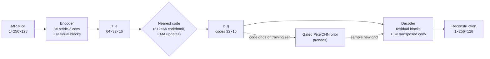
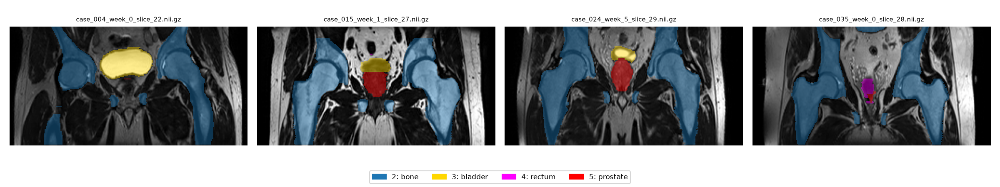

# VQ-VAE for Synthetic Prostate MRI Generation (HipMRI 2D)

**Author:** Rashim Kaur (s50419139)
**Project:** COMP3710 Report, Section 2.4 Image Generation, VQ-VAE [Hard Difficulty]

> Work in progress. Sections are filled in as the project develops.

## 1. Problem and Algorithm Overview
### 1.1 The problem

Prostate cancer radiotherapy research needs large sets of pelvic MR scans, but patient scans cannot be shared freely. A generative model that produces *synthetic* scans could, in principle, be shared instead. This creates a dilemma. If the model **memorises** its training patients, sharing its output leaks their anatomy and breaches confidentiality. If it **hallucinates** implausible anatomy, models trained on the synthetic cohort learn dangerous artefacts. This project builds a VQ-VAE generator for 2D coronal slices from the HipMRI prostate study and tests, with evidence, whether its output is faithful, diverse and non-memorised, compared with a simpler VAE baseline.

### 1.2 How the VQ-VAE works

A **VQ-VAE** (van den Oord et al., 2017) is an autoencoder whose latent space is *discrete*:

1. **Encoder.** Three stride-2 convolutions and two residual blocks map a 1×256×128 slice to a 32×16 grid of 64-dimensional vectors $z_e$.
2. **Vector quantiser.** Each vector is replaced by its nearest entry in a learned **codebook** of 512 vectors, $z_q = e_k$ with $k = \arg\min_j \lVert z_e - e_j \rVert_2$, so a slice becomes a 32×16 grid of integers.
3. **Decoder.** It mirrors the encoder (residual blocks, then transposed convolutions and a sigmoid) to rebuild the slice from $z_q$.

The training loss is

$$\mathcal{L} = \lVert x - \hat{x} \rVert_2^2 + \beta \, \lVert z_e - \mathrm{sg}[z_q] \rVert_2^2,$$

where sg is the stop-gradient operator and β = 0.25. The first term trains the decoder and encoder to reconstruct the slice. The second (the **commitment loss**) keeps encoder outputs close to their chosen codes. The argmin is not differentiable, so gradients are copied from $z_q$ to $z_e$ with the **straight-through estimator** ($z_q \leftarrow z_e + \mathrm{sg}[z_q - z_e]$). Instead of a codebook loss term, the codebook is updated with **exponential moving averages** of the encoder outputs assigned to each code (paper Appendix A.1). Two further measures prevent **codebook collapse**, a failure observed during development (Section 6.4): the codebook is initialised from real encoder outputs, and codes unused for 50 steps are restarted at random encoder outputs.

**Generating new slices** needs a model of *which code grids are plausible*. A **Gated PixelCNN** prior (van den Oord et al., 2016) is trained on the code grids of the training set to predict each code from the codes above and to the left of it. Sampling a grid code by code and passing it through the decoder produces a new slice.

**Baseline.** A convolutional **VAE** (Kingma & Welling, 2014) uses the same encoder/decoder backbone, but its latent is a continuous Gaussian (8 channels on the same 32×16 grid). It is trained with summed squared error plus a KL term, with the KL weight warmed up over 5 epochs (Bowman et al., 2016), and it generates by decoding $z \sim \mathcal{N}(0, I)$. Because the backbone is shared, the comparison isolates the effect of discrete versus continuous latents.



*Solid arrows: reconstruction (stage 1, trained first). Dotted arrows: generation (stage 2, prior trained on frozen codes).*

### 1.3 Repository structure

| File | Purpose |
|---|---|
| `dataset.py` | Loads Nifti slices, centre-crops to 256×128, normalises each slice, caches tensors, builds DataLoaders |
| `modules.py` | VQ-VAE (encoder, EMA vector quantiser, decoder), VAE baseline, Gated PixelCNN prior. Running it executes the self-tests |
| `train.py` | Training/validation loops for all three models, checkpoints, curves and logs of time and peak GPU memory |
| `predict.py` | Loads trained weights and runs the test-set evaluation, failure analysis, sampling, memorisation audit, interpolation and profiling |
| `utils.py` | SSIM (validated against scikit-image), PSNR, masked SSIM, seeding and figure helpers |
| `data_audit.py` | Pre-training dataset audit (shapes, intensities, labels, image/mask pairing, patient leakage) |
| `train.sh`, `predict.sh` | Slurm job scripts for the Rangpur cluster |

## 2. Feasibility Review (Midpoint Check-Off)
*Written for the compulsory midpoint check-off. Evidence reflects the state of the project at that point (first full training runs complete).*

**1. User need, scope and acceptance criteria.**
The user is a radiotherapy research group that wants to share a synthetic cohort of 2D pelvic MR slices with external collaborators, so that they can develop segmentation models without access to real patient scans. The prototype must answer the domain dilemma: *does the generator produce novel, diverse and anatomically coherent slices, or does it copy training patients or collapse to a few modes?* Acceptance criteria, all measured on held-out data:

| # | Criterion | Test |
|---|---|---|
| AC1 | **Fidelity:** mean test-set reconstruction SSIM > 0.6, and higher than a VAE baseline of similar size | `predict.py` evaluate, 540 test slices |
| AC2 | **Plausibility:** generated slices are structurally similar to real anatomy: median SSIM between each sample and its nearest real held-out slice > 0.6 | nearest-neighbour search over the test split |
| AC3 | **No memorisation:** at most 10% of samples lie closer to a training slice than the 5th-percentile distance of real unseen test slices to the training set (twice the rate for genuinely new patients) | memorisation audit |
| AC4 | **Diversity:** codebook perplexity > 256 of 512 codes, and uncurated sample grids show no mode collapse | training logs, sample grids |
| AC5 | **Resources:** each model trains in < 1 GPU-hour with < 8 GB peak VRAM on one A100, and generation takes < 1 s per slice | `history.json`, `profile` task |

**2. Model choice and course concepts.**
Dataset: HipMRI 2D (256×128 coronal slices), with the provided patient-level splits (31 / 4 / 3 patients) and per-slice percentile normalisation. Model: **VQ-VAE** [Hard difficulty] (van den Oord et al., 2017), using a convolutional residual encoder/decoder, a 512×64 codebook updated by exponential moving averages, a commitment loss (β = 0.25) and the straight-through gradient estimator. New slices are generated by sampling code grids from a **Gated PixelCNN** prior (van den Oord et al., 2016). Baseline: a **convolutional VAE** (Kingma & Welling, 2014) with the same backbone and latent grid, so the comparison isolates discrete versus continuous latents. Course concepts used: convolutional autoencoders, residual blocks, variational inference, autoregressive models and masked convolutions.

**3. Preliminary feasibility evidence.**
- *Data audit* (`data_audit.py`): there is no patient overlap between splits, image/mask pairing is 100%, 60 slices of width 144 are cropped to 128, and the prostate covers < 1% of pixels (so organ-level SSIM is needed in addition to whole-slice SSIM).
- *Smoke tests* exposed **codebook collapse** (perplexity 1.0 within 10 steps). It was fixed with data-dependent codebook initialisation and restarting codes unused for 50 steps, after which perplexity recovered to about 150–200 within 150 CPU steps.
- *First full runs* (40 epochs, A100): VQ-VAE validation SSIM **0.698** (PSNR 24.6 dB, perplexity 376/512) versus VAE **0.436**, using **419 MB / 305 MB** peak VRAM and about 3–4 s per epoch. This meets AC1 and AC5 on validation data.

**4. Risks, budget and fallback.**
- *Risk: incoherent samples.* The first PixelCNN (12 layers, 3×3 kernels) could see only 14 of the 32 code rows, so samples had realistic texture but no global anatomy. It has been widened to 15 layers with 5×5 kernels (a 31-row receptive field).
- *Risk: memorisation.* With only 31 training patients, the prior's validation loss reached its minimum near epoch 15 and then rose (overfitting). Mitigations are dropout, best-validation checkpointing and the audit in AC3.
- *Risk: small test set.* With 3 test patients, results are reported per patient.
- *Budget:* about 3 GPU-hours in total (ablations about 10–25 min each, PixelCNN about 10 min, evaluation < 30 min).
- *Next experiment:* an ablation on training length, an SSIM loss term and a 64×32 code grid (higher fidelity, but a 4× longer sequence for the prior), followed by the memorisation audit.
- *Fallback:* if the prior cannot produce coherent slices, report reconstruction fidelity and latent interpolation, sample at a lower temperature, and keep the 32×16 grid, where the prior is tractable.

## 3. Dataset, Pre-processing and Splits
### 3.1 Data audit

Before writing the data loader, the HipMRI 2D slice dataset (`keras_slices_data` on Rangpur) was audited with `data_audit.py`, which checks slice counts, shapes, intensity ranges, label balance, image/mask pairing and patient overlap between splits.

| Split | Slices | Patients | Slice shapes |
|---|---|---|---|
| Train | 11,460 | 31 | 256×128 (11,400), 256×144 (60) |
| Validate | 660 | 4 | 256×128 |
| Test | 540 | 3 | 256×128 |

Key findings:

- **No patient leakage.** No patient (case ID) appears in more than one split, so the provided splits are patient-level and are kept as-is (38 patients in total, matching the dataset description).
- **Image/mask pairing is complete.** Every image slice has a matching segmentation mask in all three splits.
- **Mixed slice shapes.** 60 training slices are 256×144. These are centre-cropped to 256×128 rather than resized, to avoid interpolation blur.
- **Raw MR intensities.** Values are non-negative floats with per-slice maxima varying widely (sampled maxima up to 1080, median around 400), so intensities are normalised per slice (percentile clipping, then scaling to [0, 1]).
- **Extreme class imbalance in the masks.** Sampled pixel fractions are roughly 16% label 0, 68% label 1, 12% label 2, 2% label 3, 0.5% label 4 and 0.4% label 5. Per the dataset description, the labelled regions are background, body outline, bone, bladder, rectum and prostate. The prostate occupies well under 1% of each slice, so whole-image metrics can hide poor detail in the clinically important region. Masks are therefore used during evaluation to measure reconstruction quality inside each organ.
- **Repeated scans per patient.** Patients contribute up to 480 slices across multiple weekly scans, so neighbouring training slices are highly similar. The memorisation audit accounts for this by comparing generated images against both training and held-out test patients.
- **Limitation:** the test split contains only 3 patients, so test metrics carry patient-level variance and are reported with that caveat.

### 3.2 Label verification

The label meanings were confirmed visually before being used in evaluation (`python dataset.py` saves this figure). Label 2 covers the pelvic bones and femurs, label 3 the bladder, label 4 the rectum and label 5 the prostate, directly inferior to the bladder.



### 3.3 Pre-processing (`dataset.py`)

1. **Crop.** Every slice is centre-cropped (or zero-padded) to 256×128. The 60 slices of width 144 lose 8 columns from each side, which are background.
2. **Normalise.** Each slice is clipped to its own 0.5th–99.5th intensity percentiles and scaled to [0, 1]. MR intensities have no absolute scale, and percentile clipping stops a few very bright voxels from compressing the useful range.
3. **Cache.** Pre-processed slices are cached as float16 tensors (about 1 GB, git-ignored), so later runs load in seconds instead of decoding about 12,700 Nifti files.
4. **Masks** are cropped identically and used only for evaluation, never for training the generative models.

After pre-processing, mean intensity is similar across splits (train 0.220, validate 0.236, test 0.213), so the held-out splits are not distribution-shifted. About 36% of slices contain prostate (train 36.2%, validate 38.5%, test 36.1%), so prostate-region metrics are computed only on those slices.

### 3.4 Split justification

The provided train / validate / test folders are used unchanged because the audit found no patient in more than one split. Slices from one patient are highly correlated (repeated weekly scans of the same anatomy), so a random slice-level split would leak patient anatomy into the test set and overstate both reconstruction quality and novelty in the memorisation audit.

## 4. Dependencies and Reproducibility
<!-- Exact versions, seeds, hardware, how to run. -->

## 5. Usage
All commands are run from this folder. On Rangpur, GPU work is submitted with the Slurm scripts, and short checks run on a CPU node (`srun -p cpu --cpus-per-task=2 --time=00:30:00 --pty bash`). The data path defaults to `/home/groups/comp3710/HipMRI_Study_open/keras_slices_data`; pass `--root` to use another copy.

**1. Audit the data and build the cache** (CPU, a few minutes on first run):

```bash
python data_audit.py          # prints the audit, saves audit_outputs/sample_slices.png
python dataset.py             # caches pre-processed tensors to data/cache/, saves audit_outputs/label_check.png
```

**2. Run the self-tests** (CPU, under a minute). These check shapes, codebook initialisation, recovery from codebook collapse, PixelCNN causality, and SSIM against scikit-image:

```bash
python modules.py
python utils.py
```

**3. Smoke-test training** (CPU, a few batches; catches bugs before using GPU time):

```bash
python train.py --model vqvae --smoke
python train.py --model vae --smoke
python train.py --model pixelcnn --smoke
```

**4. Train on a GPU.** The PixelCNN must be trained after the VQ-VAE, because it learns the VQ-VAE's code grids:

```bash
sbatch train.sh vqvae --epochs 150                  # -> outputs/vqvae/
sbatch train.sh vae                                 # -> outputs/vae/
sbatch --dependency=afterok:<vqvae_job_id> train.sh pixelcnn
```

Useful options: `--out-dir`, `--epochs`, `--batch-size`, `--lr`, `--n-down` (3 gives a 32×16 code grid, 2 gives 64×32), `--ssim-weight`, `--num-embeddings`, `--prior-layers`, `--prior-kernel`. Each run writes `best.pt`, `last.pt`, `history.json`, `summary.json`, `curves.png` and `recon_latest.png` to its output folder.

**5. Evaluate on the test split and generate samples:**

```bash
sbatch predict.sh                                   # all tasks -> results/
sbatch predict.sh --tasks evaluate,failures         # a subset
sbatch predict.sh --vqvae outputs/vqvae_e150/best.pt --out results/final
```

`predict.py` writes all tables to `results/report.md` and figures to `results/`. Model weights, caches and results are not committed (see `.gitignore`); figures used in this README are copied to `images/`.

<!-- TODO: example input/output figures once the final model is chosen. -->

## 6. Results
### 6.1 Baseline (VAE) vs VQ-VAE
### 6.2 Resource Profiling
### 6.3 Memorisation and Privacy Audit
### 6.4 Failure Case Autopsy
### 6.5 Recommendation to Project Manager

## 7. Artificial Intelligence Usage Disclosure
> **DRAFT. Rashim: edit this so that every statement is accurate before submission.** Add any other tools you used (e.g. GitHub Copilot or ChatGPT), and describe in your own words which parts you wrote or changed yourself.

**Tools used.** Claude (Anthropic), used through the Claude app as a coding and writing assistant throughout the project.

**What it was used for.**
- Interpreting the assessment specification and planning the project (model choice, baseline, investigation design).
- Drafting the code in all project files (`data_audit.py`, `dataset.py`, `modules.py`, `train.py`, `predict.py`, `utils.py`, Slurm scripts).
- Debugging: diagnosing codebook collapse, the bfloat16 SSIM-loss failure, the Slurm partition/account error, and git/VPN set-up problems.
- Drafting README text, including the feasibility review.

**How outputs were verified.**
- Every model file has executable self-tests that were run on Rangpur: output shapes, PixelCNN causality (perturbing one code must not change any earlier prediction), recovery from a forced codebook collapse, and SSIM agreement with `skimage.metrics.structural_similarity` (difference < 1e-4).
- Every training path was run as a CPU smoke test before any GPU job. This caught two real bugs (codebook collapse within 10 steps, and the SSIM loss failing under bfloat16 autocast), and both fixes were confirmed by re-running.
- The data audit and label overlays were checked visually against the anatomy (bladder, rectum, prostate and bones in the expected positions).
- All reported numbers come from logged runs (`history.json`, `summary.json`, `results/report.md`), not from the assistant. Model selection used the validation split only, and the test split was used once for the final evaluation.
- I read and ran all of the code, and can explain each component (quantiser, straight-through estimator, EMA updates, gated masked convolutions, the memorisation criterion).

## 8. References

1. A. van den Oord, O. Vinyals and K. Kavukcuoglu, "Neural Discrete Representation Learning," *NeurIPS*, 2017. arXiv:1711.00937.
2. A. van den Oord, N. Kalchbrenner, O. Vinyals, L. Espeholt, A. Graves and K. Kavukcuoglu, "Conditional Image Generation with PixelCNN Decoders," *NeurIPS*, 2016. arXiv:1606.05328.
3. D. P. Kingma and M. Welling, "Auto-Encoding Variational Bayes," *ICLR*, 2014. arXiv:1312.6114.
4. S. R. Bowman, L. Vilnis, O. Vinyals, A. M. Dai, R. Jozefowicz and S. Bengio, "Generating Sentences from a Continuous Space," *CoNLL*, 2016. arXiv:1511.06349.
5. Z. Wang, A. C. Bovik, H. R. Sheikh and E. P. Simoncelli, "Image Quality Assessment: From Error Visibility to Structural Similarity," *IEEE Transactions on Image Processing*, 13(4), 2004.
6. P. Dhariwal, H. Jun, C. Payne, J. W. Kim, A. Radford and I. Sutskever, "Jukebox: A Generative Model for Music," 2020. arXiv:2005.00341. (Random restarts of unused codes.)
7. C. Meehan, K. Chaudhuri and S. Dasgupta, "A Non-Parametric Test to Detect Data-Copying in Generative Models," *AISTATS*, 2020. arXiv:2004.05675.
8. J. Dowling and P. Greer, "Labelled weekly MR images of the male pelvis," CSIRO Data Collection, v2, 2021. doi:10.25919/45t8-p065.
